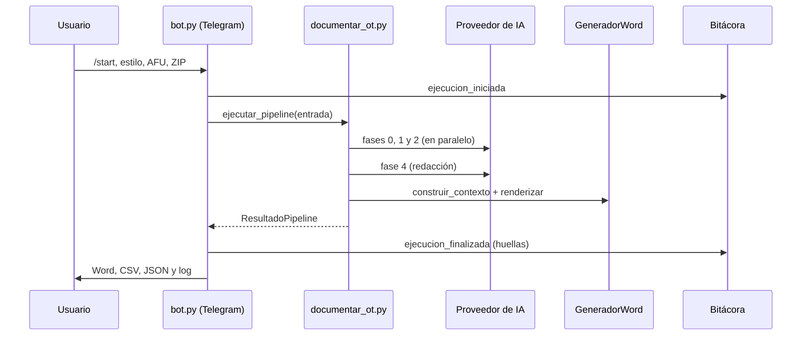

# sapdoc

Genera automáticamente el documento técnico (DTSS) de una orden de transporte
SAP ABAP. El usuario sube por chat el ZIP de la OT y, opcionalmente, un
documento de estilo y el documento funcional (AFU); la aplicación analiza el
código con IA y devuelve el Word listo para revisar.

## Estructura

```
sapdoc/
├── pyproject.toml            Dependencias, comandos y configuración de pytest
├── requirements.lock         Árbol completo de dependencias (entorno reproducible)
├── env.example               Plantilla del .env con todas las variables
├── usuarios_permitidos.example.json
├── plantillas/               Plantilla Word del DTSS técnico
├── scripts/                  Utilidades (regenerar la plantilla)
├── docs/CHANGELOG.md
├── tests/
└── src/sapdoc/
    ├── domain/               Reglas puras: sin E/S, sin IA, sin canal
    │   ├── entidades.py        Modelos, Usuario, EntradaPipeline, ResultadoPipeline
    │   ├── clasificacion.py    Qué objetos van a IA y cómo se muestra su código
    │   ├── ruido_sap.py        Catálogo de objetos autogenerados por SAP
    │   └── respuestas_ia.py    Extracción y reparación del JSON de la IA
    ├── application/          Casos de uso
    │   ├── documentar_ot.py    Caso principal: fases de IA y armado del documento
    │   ├── revision_codigo.py  Code Review opcional
    │   ├── analisis_documentos.py  Fases 0 (estilo) y 1 (AFU)
    │   ├── auditoria_ejecucion.py  Prompts y respuestas de una ejecución
    │   ├── puertos.py          Interfaces ClienteIA y GeneradorDocumento
    │   ├── textos.py           Mensajes del chat y prompts
    │   └── marcas_tiempo.py
    ├── infrastructure/       Adaptadores al exterior
    │   ├── config.py           Lee y valida .env y usuarios_permitidos.json
    │   ├── ia.py               Cliente NVIDIA / Azure OpenAI / compatible con OpenAI
    │   ├── zip_ot.py           Lectura del ZIP de la OT
    │   ├── lectura_documentos.py  Texto de PDF y Word
    │   ├── bitacora.py         Registro de auditoría permanente (JSONL encadenado)
    │   └── word/               Generación del Word (plantilla o sobre el AFU)
    └── interfaces/
        └── telegram/bot.py   Canal Telegram
```

Las dependencias solo apuntan hacia dentro: `interfaces` → `infrastructure` →
`application` → `domain`. El caso de uso no conoce Telegram, ni el proveedor de
IA, ni cómo se genera el Word: los recibe a través de los puertos.
`tests/test_arquitectura.py` falla si alguien rompe esa regla.

## Instalación

Requiere Python 3.13.

```powershell
python -m venv venv
.\venv\Scripts\python.exe -m pip install -r requirements.lock
.\venv\Scripts\python.exe -m pip install -e ".[dev]" --no-deps
```

`requirements.lock` instala las versiones exactas; el segundo paso instala el
paquete en modo editable (los cambios en `src/` se ven sin reinstalar).

## Configuración

1. Copiar `env.example` como `.env` y completar al menos `TELEGRAM_BOT_TOKEN` y
   la clave del proveedor de IA. El archivo documenta cada variable.
2. Copiar `usuarios_permitidos.example.json` como `usuarios_permitidos.json` y
   poner los usuarios autorizados. Si un usuario no conoce su ID, puede
   escribirle al bot: si no está autorizado, el bot se lo responde.

Ambos archivos están fuera de git. Si algo falta o es inválido, el bot no
arranca y lista todos los problemas.

## Ejecución

Desde la raíz del proyecto (las rutas de plantilla, usuarios y auditoría son
relativas a ella):

```powershell
.\venv\Scripts\python.exe -m sapdoc          # o: .\venv\Scripts\sapdoc-telegram
```

Comprobar que nadie alteró el registro de auditoría:

```powershell
.\venv\Scripts\sapdoc-verificar-auditoria auditoria\eventos.jsonl
```

Tests:

```powershell
.\venv\Scripts\python.exe -m pytest
```

## Flujo de ejecución

### 1. Arranque

`python -m sapdoc` ejecuta `interfaces/telegram/bot.py: main()`:

1. `infrastructure/config.py: cargar_config()` lee el `.env` y
   `usuarios_permitidos.json`, valida todo y devuelve un `Config`.
2. `bot.py: construir_app()` deja en `bot_data` lo que comparten todas las
   conversaciones: la configuración, el cliente de IA
   (`infrastructure/ia.py: crear_cliente_ia()`), la bitácora
   (`infrastructure/bitacora.py: Bitacora`) y el generador de Word
   (`infrastructure/word: GeneradorWord`).
3. El bot queda escuchando mensajes (long-polling).

### 2. Cada mensaje: control de acceso

Antes que cualquier otro manejador corre `bot.py: control_acceso()`. Si el
chat no es privado o el usuario no está en la lista, registra
`acceso_denegado` en la bitácora y corta el mensaje: no se descarga nada ni
se llama a la IA.

### 3. Conversación

| Paso | Función (`bot.py`) | Qué hace |
|---|---|---|
| `/start` | `start_command` | Limpia la conversación anterior y pide el documento de estilo |
| Estilo | `handle_calibration` / `skip_calibration` | Guarda huella y texto del documento, o lo salta |
| AFU | `handle_afu` | Guarda huella, texto y el .docx original |
| ZIP | `handle_zip` | `infrastructure/zip_ot.py: leer_zip_ot()` extrae metadata y fuentes; ofrece los botones |
| Elección | `handle_cr_choice` | Genera directamente o ejecuta antes el Code Review (`application/revision_codigo.py`) |
| Hallazgos | `handle_cr_decision` | El usuario los ignora (queda registrado) o cancela |
| Generación | `execute_pipeline` | Ver el punto 4 |

### 4. Generación del documento

`bot.py: execute_pipeline()`:

1. Registra `ejecucion_iniciada` en la bitácora (usuario, OT, huellas de los
   archivos, modo, Code Review, modelos).
2. Llama al caso de uso `application/documentar_ot.py: ejecutar_pipeline()`.
3. Registra `ejecucion_finalizada` con las huellas de lo generado
   (`registrar_fin_ejecucion`).
4. Envía al usuario el log de prompts, el Word, los CSV y el JSON, y borra
   cada archivo temporal.

Dentro de `ejecutar_pipeline()`:

1. **Clasificación** (`domain/clasificacion.py: clasificar_objetos_previos`):
   separa los objetos con lógica (van a IA) del diccionario y del ruido técnico
   de SAP (se documentan directo desde la metadata, sin IA).
2. **Fases 0, 1 y 2 en paralelo**: estilo (`task_phase_0`), requerimientos del
   AFU (`task_phase_1`) y un análisis por cada objeto con lógica
   (`task_phase_2`, con reintentos). Las respuestas se leen con
   `domain/respuestas_ia.py: parsear_json_lote`, y el nombre y el tipo de cada
   objeto se toman siempre de la metadata, no de la IA.
3. **Contenido del documento**: el código de cada objeto sale del fuente real
   (`obtener_codigo_objeto`: completo si es nuevo, líneas nuevas y anteriores
   si se modificó); la IA nunca lo transcribe.
4. **Fase 4, redacción**: la IA escribe la justificación y la explicación de
   cada objeto usando el AFU como contexto.
5. **Word**: `GeneradorWord` lo arma con la plantilla (modo técnico) o
   añadiendo las secciones 5, 6 y 7 al AFU del usuario (modo completo), y
   exporta cada tabla de customizing a CSV.

Si algo falla, `ejecutar_pipeline()` no lanza la excepción: devuelve un
`ResultadoPipeline` con el mensaje de error y lo que alcanzó a generar, y el
registro de prompts anota la causa.



## Auditoría

Hay dos registros distintos:

- **Registro de prompts** (`application/auditoria_ejecucion.py`): lo que se
  envió a la IA y lo que respondió en cada fase. Se entrega al usuario como
  `.txt` con cada documento.
- **Bitácora** (`infrastructure/bitacora.py`, `auditoria/eventos.jsonl`):
  quién hizo qué y cuándo, con huellas SHA-256 de entradas y salidas pero sin
  el contenido. Cada línea está encadenada a la anterior.
  `sapdoc-verificar-auditoria` detecta líneas modificadas, borradas o
  reordenadas; no impide que alguien con acceso de escritura regenere la
  cadena entera.
